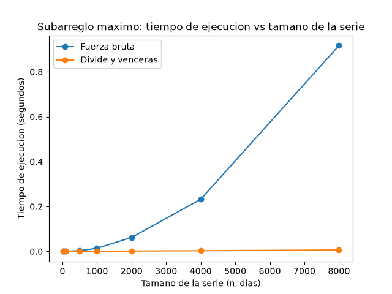

# Laboratorio evaluativo 2 — Dividir y vencer

**Nombre:** Santiago Martínez

## Cómo reproducir

Desde la raíz del repositorio, con el entorno virtual activado:

```bash
source venv/Scripts/activate      # en Linux/Mac: source venv/bin/activate
pip install -r requirements.txt
cd lab2-divide-y-vencer
python pruebas.py                 # imprime "Todas las pruebas pasaron" si todo está bien
python medicion.py                # imprime los tiempos y genera graficas/tiempo_vs_n.png
```

---

## Parte 1 — Implementar y verificar

Código: [`subarreglo.py`](subarreglo.py) (las tres funciones) y [`pruebas.py`](pruebas.py) (las verificaciones).

Las pruebas son `assert` y comparan la **suma** de cada resultado, no los índices, porque puede haber varios tramos con la misma suma máxima. Los casos que cubren son:

- La serie de ocho días de la situación problema (`[-3, 5, -2, 8, -6, 3, 9, -4]`), que debe dar 17 en las dos funciones.
- Una serie de un solo elemento (uno positivo y uno negativo).
- Una serie con todos los valores negativos, donde el resultado es el menos negativo.
- Una serie con todos los valores positivos, donde el tramo es la serie completa.
- Un caso donde el mejor tramo cruza el punto medio (`[-5, -5, -5, 6, 7, -5, -5, -5]`, tramo de los índices 3 a 4 con suma 13), para comprobar que `suma_cruzada` está bien.
- Que ninguna de las dos funciones modifica la lista que recibe.
- 50 listas aleatorias de entre 1 y 60 elementos (semilla fija) en las que la fuerza bruta y el divide y vencerás tienen que dar la misma suma.

---

## Parte 2 — Medir y graficar

Código: [`medicion.py`](medicion.py).

Medí ocho tamaños: 10, 50, 100, 500, 1000, 2000, 4000 y 8000. Los datos son enteros entre -100 y 100 generados con semilla fija, y para cada tamaño las dos funciones reciben la misma lista. Antes de medir, el script comprueba que ambas dan la misma suma. Cada medición se repitió tres veces con `time.perf_counter()` (solo se cronometra la llamada al algoritmo, no la generación de datos) y se grafica la mediana.



Valores medidos (mediana de 3 corridas):

| n | Fuerza bruta (s) | Divide y vencerás (s) |
|---|---|---|
| 10 | 0,000003 | 0,000006 |
| 50 | 0,000032 | 0,000027 |
| 100 | 0,000121 | 0,000057 |
| 500 | 0,003419 | 0,000329 |
| 1000 | 0,013944 | 0,000734 |
| 2000 | 0,062012 | 0,001525 |
| 4000 | 0,232381 | 0,002992 |
| 8000 | 0,917274 | 0,006343 |

---

## Parte 3 — Análisis

**1. Recurrencia.** En `subarreglo_maximo` cada llamada parte la serie en dos mitades y se llama a sí misma una vez por mitad, así que hay 2 subproblemas de tamaño n/2. Además hace el caso cruzado con `suma_cruzada`, que recorre desde el punto medio hacia la izquierda y hacia la derecha, en total a lo sumo n elementos: Θ(n). Elegir el mejor de los tres resultados son un par de comparaciones, Θ(1), que no cambia el orden. Queda T(n) = 2T(n/2) + Θ(n). Con el método maestro: a = 2, b = 2, entonces n^(log₂2) = n. Como f(n) = Θ(n) es del mismo orden que n^(log_b a), se cumple la condición del caso 2 y T(n) = Θ(n log n). La fuerza bruta es Θ(n²) porque tiene dos ciclos anidados: para cada inicio i recorre todos los fines j ≥ i, o sea n + (n−1) + … + 1 = n(n+1)/2 pares, y cada par cuesta una suma y una comparación, trabajo constante.

**2. Lo medido contra lo esperado.** En la gráfica la fuerza bruta sube cada vez más rápido (de 0,06 s en n = 2000 a 0,92 s en n = 8000), mientras que divide y vencerás se ve casi pegada al eje horizontal, llegando apenas a 0,006 s en n = 8000. Al duplicar de 4000 a 8000, el tiempo de la fuerza bruta se multiplicó por 0,917 / 0,232 ≈ 3,95, muy cerca del 4 que predice Θ(n²) (duplicar n multiplica n² por 4). El de divide y vencerás se multiplicó por 0,00634 / 0,00299 ≈ 2,12, y para Θ(n log n) se espera 2 · log₂8000 / log₂4000 ≈ 2,17, así que también coincide. Con 2000 → 4000 pasa lo mismo (3,75 y 1,96).

**3. Tamaños pequeños.** Sí hay un punto de cruce en mi rango. Con n = 10 la fuerza bruta es más rápida (3 µs contra 6 µs), pero con n = 50 divide y vencerás ya gana por poco (27 µs contra 32 µs), y con n = 100 es casi el doble de rápido (57 µs contra 121 µs). Entonces el cruce está entre 10 y 50 días. A tamaños tan chicos pesa más el costo de las llamadas recursivas y de armar tuplas en cada llamada que la ventaja asintótica, por eso la ventaja no se nota desde el principio.

**4. ¿Cuándo conviene dividir?** Para hallar el máximo de un arreglo, dividir por la mitad da T(n) = 2T(n/2) + Θ(1), porque combinar es una sola comparación. Con el método maestro, n^(log₂2) = n y f(n) = Θ(1) es polinomialmente menor, caso 1, así que T(n) = Θ(n). Recorrerlo una vez con un `for` ya es Θ(n), entonces dividir no mejora nada y solo agrega llamadas recursivas. En el subarreglo máximo sí sirve porque la alternativa directa es Θ(n²) y dividir la baja a Θ(n log n), pagando un combinar lineal que sí compensa.

**5. Concepto para la gerente.** Recomiendo divide y vencerás. Con 8000 registros ya es unas 145 veces más rápido (0,0063 s contra 0,92 s) y la diferencia crece con el tamaño. **Esto es una estimación, no una medición.** Para 1.000.000 de registros, n es 125 veces más grande que 8000. La fuerza bruta crece como n², así que tardaría 0,917 · 125² ≈ 14.300 s, unas 4 horas. Divide y vencerás crece como n log n: el factor es 125 · (log₂10⁶ / log₂8000) ≈ 125 · 1,54 ≈ 192, o sea 0,0063 · 192 ≈ 1,2 s. Supongo que el comportamiento sigue la misma forma que medí y que el computador no cambia; con series tan grandes la memoria y el caché pueden mover los números, pero la diferencia de horas contra segundos no cambiaría.
